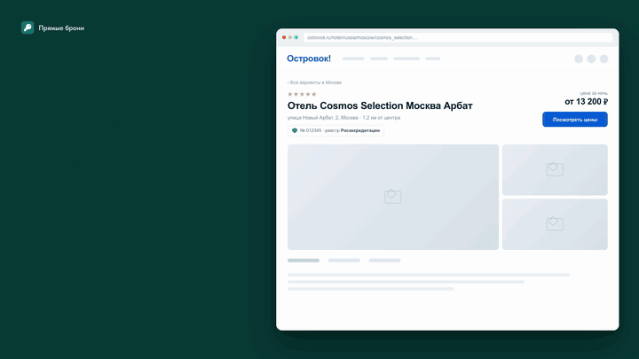
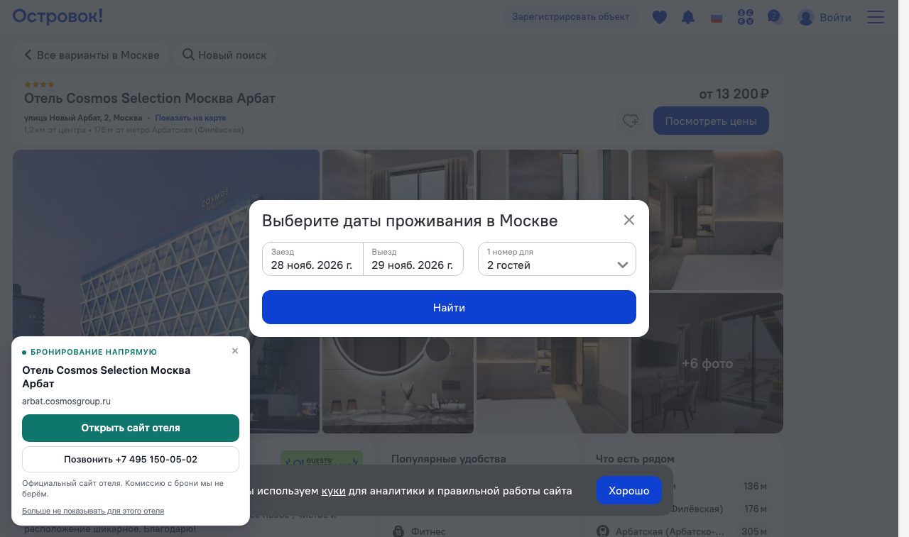
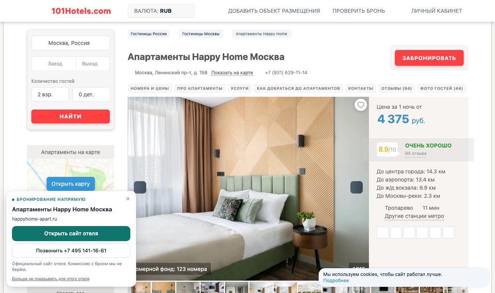

<div align="center">


# Прямые брони (Direct Bookings)

**A free extension for Chrome, Yandex Browser and Opera: on a hotel's page in an aggregator
it shows the hotel's official website and phone number, so you can book directly, without the middleman's commission.**

[](https://github.com/antonbru/hotel-direct/actions/workflows/ci.yml)
[](https://github.com/antonbru/hotel-direct/releases)
[](LICENSE)
[](extension/manifest.json)
[](#-installation)
[](#-installation)
[](#-installation)
[](https://github.com/antonbru/hotel-direct/stargazers)

[🎬 Demo](#-demo) · [🚀 Installation](#-installation) · [⚙️ How it works](#️-how-it-works) · [🤝 Contributing](#-contributing) · [🗺️ Roadmap](#️-roadmap)

[Русский](README.md) · **English**

</div>

> [!IMPORTANT]
> The project is **free and open source** ([MIT](LICENSE)). There is nothing commercial inside: the extension
> takes no commission on bookings, inserts no affiliate links, collects no data
> and does not change prices. This is a matter of principle, not a temporary state of affairs.

## 🎬 Demo



[Full video, 30 s, 1080p](docs/promo/hotel-direct-promo.mp4) ·
[promo page](docs/promo/index.html) ·
[live screenshots](docs/)

## 🧩 What it does

- 🏨 A compact card with the hotel's **official website** appears on the hotel's page in the aggregator.
- 📞 If the registry has no website, it shows the **phone number**, so you can call directly.
- 🔗 The link opens only when you click it: no automatic redirects and no replacing of the aggregator's buttons.
- 🙈 «Больше не показывать для этого отеля» (“Don't show for this hotel again”) remembers your choice locally.
- ⚙️ Settings: turn the card off entirely, reset hidden hotels.

The guest saves the 15–25 % commission, the hotel gets a direct channel and the guest's contact.
The extension itself earns nothing from this.

## 🚀 Installation

For now the extension is installed manually (publishing to the Chrome Web Store and Opera Add-ons is on the [roadmap](#️-roadmap)).

1. Download `hotel-direct-x.y.z.zip` from [Releases](https://github.com/antonbru/hotel-direct/releases) and unpack it.
2. Open `chrome://extensions` (in Yandex Browser: `browser://extensions`, in Opera: `opera:extensions`).
3. Turn on **Developer mode** → **Load unpacked** → select the folder.
4. Open a hotel page on [Островок (Ostrovok)](https://ostrovok.ru) or [101hotels](https://101hotels.com).

Updating to a new version: replace the files and click ⟳ on the extension's card,
then reload the hotel page — the content script is not injected into an already open tab.

## ⚙️ How it works

```text
страница отеля ──► реестровый номер / UUID ──► API Росаккредитации ──► карточка
   (Островок)        (DOM или состояние          (сайт, телефон)       (Shadow DOM)
                       страницы __NEXT_DATA__)
```

In English: hotel page (Островок) → registry number / UUID (from the DOM or the page state `__NEXT_DATA__`)
→ Росаккредитация API (website, phone) → card (Shadow DOM).

1. The content script finds, on the hotel page, a link to the **Единый реестр объектов классификации**
   (Unified Register of Classified Facilities). It first looks at the «Аккредитация» (“Accreditation”) block in the DOM,
   and if the aggregator did not render it, it reads the page state (`__NEXT_DATA__` → `facts.register.link`).
2. The service worker requests `GET tourism.fsa.gov.ru/api/v1/resorts/hotels/{uuid}/main`
   and takes `websiteAddress` and `phone`. Cache: 30 days.
3. The card is drawn in a Shadow DOM in the bottom-left corner and does not clash with the site's styles.

**Why this is possible at all.** Since 1 September 2025, aggregators in Russia are required to list
only properties with a valid entry in the registry. That is why the registry number is right there
on the hotel's page, and the registry, run by Росаккредитация (Rosaccreditation, the Federal Service for Accreditation),
has an open API that needs no key.

More details, with figures and checks (in Russian): [docs/research.md](docs/research.md).

## 🖼️ Screenshots

<p>
  
  
</p>

## 🔒 Privacy

- No analytics, cookies, advertising identifiers or third-party scripts.
- The only external address is `tourism.fsa.gov.ru` (the open registry).
- Stored in the browser: settings, the list of hidden hotels, the cache of registry responses.

Details (in Russian): [docs/PRIVACY.md](docs/PRIVACY.md).

## 📊 Data and coverage

| Metric | Value |
|---|---|
| Entries in the registry | 51,713 |
| Active properties | 41,453 |
| Website in the registry | 56 % of active ones (Moscow: 59 %) |
| Phone in the registry | 78 % |
| Junk in the website field | ~10 %: `vk.com`, auto-generated `*.clients.site` sites |

## ⚠️ Honest limitations

- Not every hotel has a website: roughly half of the hotel pages will show only a phone number.
- Hotels outside Russia are not in the registry.
- If the hotel page has neither the «Аккредитация» block nor a registry number in the page
  state, the extension stays silent. We don't match by name yet: without an index
  this produces false matches.
- Яндекс Путешествия (Yandex Travel) is not supported yet.
- Prices are not compared: the extension does not claim that “direct is cheaper” in every case.

## 🛠️ Development

All you need is Node.js 20+. The extension itself has no external dependencies.

```bash
npm run check   # синтаксис + валидация манифеста + 21 тест
npm run build   # dist/hotel-direct-<версия>.zip
npm run live -- "<url карточки отеля>"   # проверка в headless Chrome + скриншот
```

(`check`: syntax + manifest validation + 21 tests; `build`: builds the zip;
`live`: checks a hotel page URL in headless Chrome and takes a screenshot.)

Structure:

```text
extension/
  manifest.json          MV3; права: storage + tourism.fsa.gov.ru
  background.js          единственное место сетевых запросов, кэш 30 дней
  lib/registry.js        нормализация ответа реестра, фильтр мусорных сайтов
  content/extract.js     DOM и состояние страницы → UUID отеля
  content/card.js        карточка в Shadow DOM
  options.html/js/css    настройки
tests/                   node:test, без зависимостей
scripts/                 сборка, валидация, иконки, live-check, рендер промо
docs/                    исследование, приватность, скриншоты, промо
docs/brand/              логотип: SVG-исходник, растры, правила
```

| Path | Purpose |
|---|---|
| `extension/manifest.json` | MV3; permissions: `storage` + `tourism.fsa.gov.ru` |
| `extension/background.js` | the only place that makes network requests; 30-day cache |
| `extension/lib/registry.js` | normalizes the registry response, filters out junk websites |
| `extension/content/extract.js` | DOM and page state → hotel UUID |
| `extension/content/card.js` | the card in a Shadow DOM |
| `extension/options.html/js/css` | settings |
| `tests/` | `node:test`, no dependencies |
| `scripts/` | build, validation, icons, live-check, promo rendering |
| `docs/` | research, privacy, screenshots, promo |
| `docs/brand/` | logo: SVG source, rasters, guidelines |

## 🤝 Contributing

The project is open to everyone: bug reports, ideas, code, design, legal expertise.

- 🐞 Found a problem? Open a [“Bug” issue](https://github.com/antonbru/hotel-direct/issues/new?template=bug_report.yml).
  A link to the hotel page is required.
- 💡 Have an idea? Open an [“Idea” issue](https://github.com/antonbru/hotel-direct/issues/new?template=feature_request.yml).
- 🧑‍💻 Want to write code? See [`good first issue`](https://github.com/antonbru/hotel-direct/labels/good%20first%20issue)
  and [`help wanted`](https://github.com/antonbru/hotel-direct/labels/help%20wanted), and write «беру» (“I'll take it”) in the issue.
- 💬 Questions: [Discussions](https://github.com/antonbru/hotel-direct/discussions).

The full workflow, code rules and review process (in Russian): **[CONTRIBUTING.md](CONTRIBUTING.md)**.
Vulnerabilities: report privately, as described in [SECURITY.md](SECURITY.md).

## 🗺️ Roadmap

- [x] Островок: card with website and phone
- [x] 101hotels: card with website and phone
- [x] Fallback to the page state when the «Аккредитация» block is not in the DOM
- [ ] Яндекс Путешествия (SPA + captcha, needs a DOM spike)
- [ ] Bundled registry index and matching by name + coordinates
- [ ] Publishing to the Chrome Web Store and Opera Add-ons (and installing in Yandex Browser from there too)
- [ ] English version of the README and the interface
- [ ] Nightly check on live hotel pages in CI

## 📄 License

[MIT](LICENSE) © Anton Belitskiy and contributors.

The project is not affiliated with Островок, 101hotels, Яндекс (Yandex) or Росаккредитация.
The data comes from the open registry; trademarks belong to their owners.
