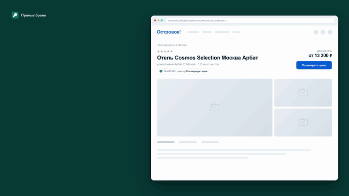
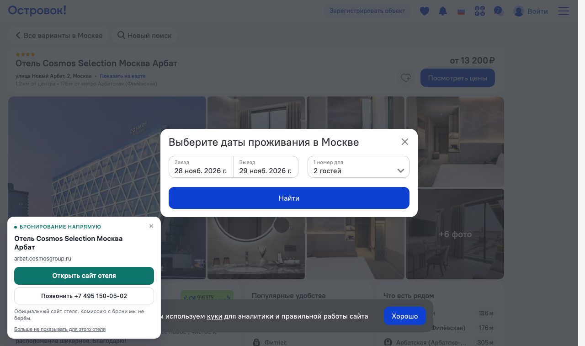
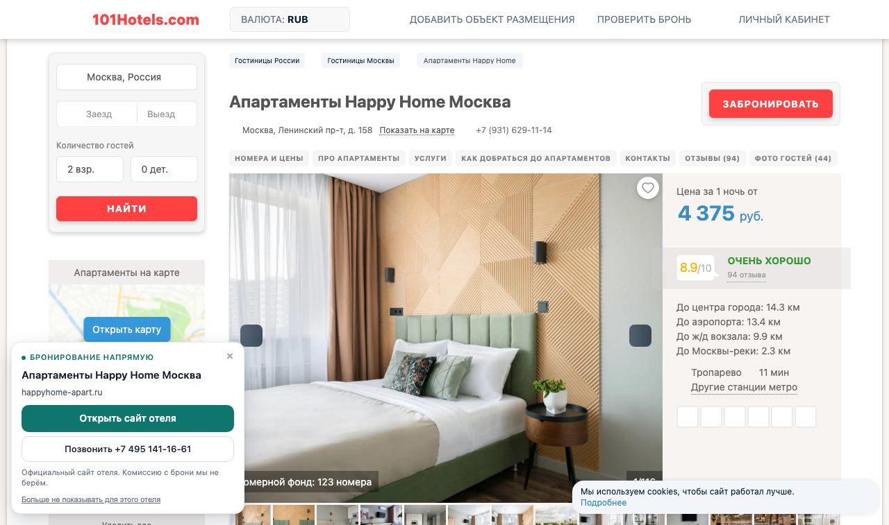

<div align="center">


# Отель напрямую

**Бесплатное расширение для Chrome и Яндекс Браузера: на странице отеля в агрегаторе
показывает его официальный сайт и телефон — чтобы бронировать напрямую, без комиссии посредника.**

[](https://github.com/antonbru/hotel-direct/actions/workflows/ci.yml)
[](https://github.com/antonbru/hotel-direct/releases)
[](LICENSE)
[](extension/manifest.json)
[](#-установка)
[](#-установка)
[](https://github.com/antonbru/hotel-direct/stargazers)

[🎬 Демо](#-демо) · [🚀 Установка](#-установка) · [⚙️ Как работает](#️-как-это-работает) · [🤝 Участие](#-участие-в-разработке) · [🗺️ Планы](#️-планы)

</div>

> [!IMPORTANT]
> Проект **бесплатный и открытый** ([MIT](LICENSE)). Внутри нет коммерции: расширение
> не берёт комиссию с брони, не вставляет партнёрские ссылки, не собирает данные
> и не подменяет цены. Это принципиальная позиция, а не временное состояние.

## 🎬 Демо



[Полный ролик, 30 с, 1080p](docs/promo/hotel-direct-promo.mp4) ·
[промо-страница](docs/promo/index.html) ·
[живые скриншоты](docs/)

## 🧩 Что делает

- 🏨 На карточке отеля в агрегаторе появляется компактная карточка с **официальным сайтом** отеля.
- 📞 Если сайта в реестре нет — показывает **телефон**, чтобы позвонить напрямую.
- 🔗 Ссылка открывается только по клику: никаких автопереходов и подмены кнопок агрегатора.
- 🙈 «Больше не показывать для этого отеля» — запоминает выбор локально.
- ⚙️ Настройки: выключить карточку целиком, сбросить скрытые.

Гость экономит 15–25 % комиссии, отель получает прямой канал и контакт гостя.
Расширение при этом ничего не зарабатывает.

## 🚀 Установка

Пока расширение ставится вручную (публикация в Chrome Web Store — в [планах](#️-планы)).

1. Скачайте `hotel-direct-x.y.z.zip` из [Releases](https://github.com/antonbru/hotel-direct/releases) и распакуйте.
2. Откройте `chrome://extensions` (в Яндекс Браузере — `browser://extensions`).
3. Включите **Режим разработчика** → **Загрузить распакованное расширение** → выберите папку.
4. Откройте карточку отеля на [Островке](https://ostrovok.ru) или [101hotels](https://101hotels.com).

Обновление после новой версии: заменить файлы и нажать ⟳ на карточке расширения,
затем обновить страницу отеля — content script не внедряется в уже открытую вкладку.

## ⚙️ Как это работает

```text
страница отеля ──► реестровый номер / UUID ──► API Росаккредитации ──► карточка
   (Островок)        (DOM или состояние          (сайт, телефон)       (Shadow DOM)
                       страницы __NEXT_DATA__)
```

1. Content script находит в карточке ссылку на **Единый реестр объектов классификации**.
   Сначала смотрит блок «Аккредитация» в DOM, а если агрегатор его не отрисовал —
   читает состояние страницы (`__NEXT_DATA__` → `facts.register.link`).
2. Service worker запрашивает `GET tourism.fsa.gov.ru/api/v1/resorts/hotels/{uuid}/main`
   и берёт `websiteAddress` и `phone`. Кэш — 30 дней.
3. Карточка рисуется в Shadow DOM в левом нижнем углу и не пересекается со стилями сайта.

**Почему это вообще возможно.** С 1 сентября 2025 года агрегаторы обязаны показывать
только объекты с действующей записью в реестре. Поэтому реестровый номер есть прямо
на странице отеля, а у реестра открытый API без ключа.

Подробнее, с цифрами и проверками: [docs/research.md](docs/research.md).

## 🖼️ Как выглядит

<p>
  
  
</p>

## 🔒 Приватность

- Нет аналитики, cookies, рекламных идентификаторов и сторонних скриптов.
- Единственный внешний адрес — `tourism.fsa.gov.ru` (открытый реестр).
- В хранилище браузера: настройки, список скрытых отелей, кэш ответов реестра.

Подробно: [docs/PRIVACY.md](docs/PRIVACY.md).

## 📊 Данные и покрытие

| Показатель | Значение |
|---|---|
| Записей в реестре | 51 713 |
| Действующих объектов | 41 453 |
| Сайт в реестре | 56 % действующих (Москва — 59 %) |
| Телефон в реестре | 78 % |
| Мусор в поле сайта | ~10 %: `vk.com`, автосайты `*.clients.site` |

## ⚠️ Честные ограничения

- Сайт есть не у всех отелей: примерно половина карточек покажет только телефон.
- Зарубежные отели в реестр не входят.
- Если на карточке нет ни блока «Аккредитация», ни реестрового номера в состоянии
  страницы — расширение молчит. Сопоставление по названию пока не делаем: без индекса
  это даёт ложные привязки.
- Яндекс Путешествия пока не поддерживаются.
- Цены не сравниваются: расширение не утверждает, что «напрямую дешевле» в каждом случае.

## 🛠️ Разработка

Нужен только Node.js 20+. У самого расширения внешних зависимостей нет.

```bash
npm run check   # синтаксис + валидация манифеста + 20 тестов
npm run build   # dist/hotel-direct-<версия>.zip
npm run live -- "<url карточки отеля>"   # проверка в headless Chrome + скриншот
```

Структура:

```text
extension/
  manifest.json          MV3; права: storage + tourism.fsa.gov.ru
  background.js          единственное место сетевых запросов, кэш 30 дней
  lib/registry.js        нормализация ответа реестра, фильтр мусорных сайтов
  content/extract.js     DOM и состояние страницы → UUID отеля
  content/card.js        карточка в Shadow DOM
  options.html/js/css    настройки
tests/                   node:test, без зависимостей
scripts/                 сборка, валидация, иконки, live-check, рендер промо
docs/                    исследование, приватность, скриншоты, промо
docs/brand/              логотип: SVG-исходник, растры, правила
```

## 🤝 Участие в разработке

Проект открыт для людей: баг-репорты, идеи, код, дизайн, юридическая экспертиза.

- 🐞 Нашли проблему — [issue «Баг»](https://github.com/antonbru/hotel-direct/issues/new?template=bug_report.yml).
  Ссылка на карточку отеля обязательна.
- 💡 Есть идея — [issue «Идея»](https://github.com/antonbru/hotel-direct/issues/new?template=feature_request.yml).
- 🧑‍💻 Хотите код — смотрите [`good first issue`](https://github.com/antonbru/hotel-direct/labels/good%20first%20issue)
  и [`help wanted`](https://github.com/antonbru/hotel-direct/labels/help%20wanted), напишите в issue «беру».
- 💬 Вопросы — [Discussions](https://github.com/antonbru/hotel-direct/discussions).

Полный порядок действий, правила кода и ревью: **[CONTRIBUTING.md](CONTRIBUTING.md)**.
Уязвимости — приватно, по [SECURITY.md](SECURITY.md).

## 🗺️ Планы

- [x] Островок: карточка с сайтом и телефоном
- [x] 101hotels: карточка с сайтом и телефоном
- [x] Фолбэк на состояние страницы, когда блока «Аккредитация» нет в DOM
- [ ] Яндекс Путешествия (SPA + капча, нужен спайк по DOM)
- [ ] Вшитый индекс реестра и сопоставление по названию + координатам
- [ ] Публикация в Chrome Web Store (и установка в Яндекс Браузер оттуда же)
- [ ] Английская версия README и интерфейса
- [ ] Ночная проверка на живых карточках в CI

## 📄 Лицензия

[MIT](LICENSE) © Anton Belitskiy и участники проекта.

Проект не аффилирован с Островком, 101hotels, Яндексом и Росаккредитацией.
Данные берутся из открытого реестра, товарные знаки принадлежат их владельцам.
